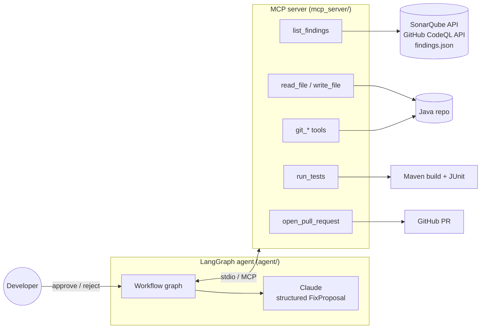
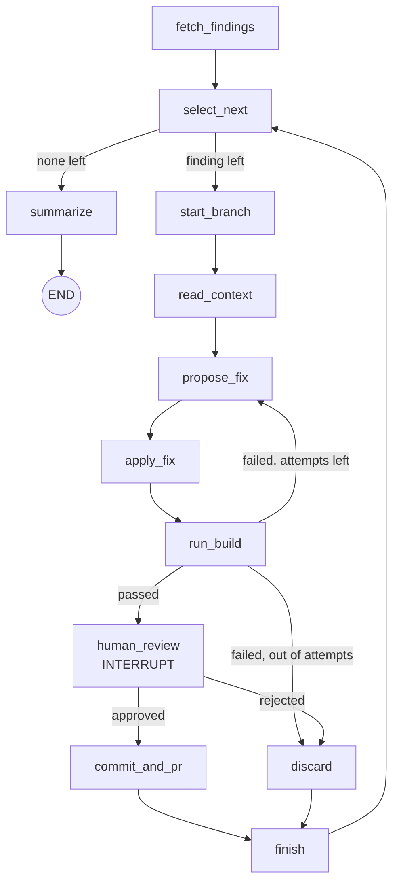

# Code Quality Remediation Agent

An AI agent that takes **SonarQube / CodeQL findings** from a Java Spring Boot codebase, **fixes them, writes a JUnit test, runs the Maven build, retries on failure**, and — only after a **human approves the diff** — commits the change and opens a pull request.

Built with **LangGraph** (workflow + human-in-the-loop), **MCP** (Model Context Protocol, for tools) and **Claude** (fix generation).

---

## Why this is a good first agent

| Property | Why it matters |
|---|---|
| Clear goal | "Make the finding go away without breaking the build." |
| Objective success check | The Maven build and unit tests pass. |
| Bounded blast radius | The agent can only edit `.java` files in `src/main/java` and `src/test/java`, only on `ai-fix/*` branches. |
| Human control | Every change is shown as a diff and needs explicit approval before a commit or PR. |
| Real value | Clears security and quality debt that teams rarely have time for. |

---

## Architecture



### Workflow graph



**The agentic loop:** when the build fails, the error output is fed back to the model, which corrects its own change (up to `MAX_ATTEMPTS`). The model *observes* results and *re-plans*, rather than producing a single answer.

**Human in the loop:** `human_review` calls LangGraph's `interrupt()`. The graph's state is saved by the checkpointer and execution pauses until the reviewer resumes it with `Command(resume={"approved": ..., "comment": ...})`.

---

## Project layout

```
code-quality-agent/
├── agent/
│   ├── graph.py       # LangGraph nodes, routing, interrupt
│   ├── state.py       # AgentState, Finding, FixProposal (pydantic structured output)
│   ├── prompts.py     # system + fix prompts (incl. retry-with-build-error prompt)
│   ├── config.py      # settings from environment variables
│   └── run.py         # CLI: connects to the MCP server, runs the graph, handles review
├── mcp_server/
│   ├── server.py      # FastMCP server: the ONLY place side effects happen
│   └── sources.py     # findings from findings.json, SonarQube or GitHub CodeQL
├── demo-java-app/     # small Maven project seeded with 3 real findings
│   ├── findings.json
│   └── src/...
├── requirements.txt
├── .env.example
└── setup_demo.sh
```

### MCP tools

| Tool | What it does | Guardrail |
|---|---|---|
| `list_findings` | Fetches open findings, most severe first | Read-only; `.java` files only; severity filter |
| `read_file` | Reads a repo file | Path must resolve inside the repo; size limit |
| `write_file` | Writes a full Java file | Only `.java` under `src/main/java` or `src/test/java` (checked on the resolved path) |
| `run_tests` | `mvn -B -q test` | Fixed command, no shell, timeout |
| `git_start_branch` | New `ai-fix/*` branch from base | Branch name pattern; refuses a dirty working tree |
| `git_diff` | Diff including new files | Read-only |
| `git_discard` | Reset and return to base | Only cleans `src/` |
| `git_commit_and_push` | Commit + push | Refuses any branch that is not `ai-fix/*`; no push in `DRY_RUN` |
| `open_pull_request` | `gh pr create` with label `ai-generated` | Head must be `ai-fix/*`; skipped in `DRY_RUN` |

---

## Run the demo

Prerequisites: Python 3.11+, Java 17, Maven, git, an Anthropic API key. (`gh` CLI only if you open real PRs.)

```bash
./setup_demo.sh                       # venv + deps, makes demo-java-app a git repo, runs its tests
cp .env.example .env                  # add ANTHROPIC_API_KEY
set -a; source .env; set +a
python -m agent.run                   # review each fix interactively
python -m agent.run --auto-reject     # safe dry run: fixes and builds, approves nothing
```

The demo app has three seeded findings:

| Finding | File | Expected fix |
|---|---|---|
| `java/sql-injection` (CodeQL, CRITICAL) | `ClaimLookupDao.java` | `PreparedStatement` with a bind parameter + H2-backed JUnit test |
| `java:S2245` (Sonar, CRITICAL) | `ReferenceNumberGenerator.java` | `SecureRandom` instead of `Random` |
| `java:S108` (Sonar, MAJOR) | `AccumulatorCalculator.java` | Stop swallowing the exception (rethrow as `IllegalArgumentException`) + test |

With `DRY_RUN=true` (the default), approved fixes are committed to local `ai-fix/*` branches only, so you can inspect them with `git log --all` and `git diff main ai-fix/...`.

### Point it at a real project

```bash
REPO_ROOT=/path/to/your/service
FINDINGS_SOURCE=sonar      # SONAR_URL, SONAR_PROJECT_KEY, SONAR_TOKEN
# or
FINDINGS_SOURCE=codeql     # GITHUB_REPO, GITHUB_TOKEN
DRY_RUN=false              # only when you want pushes and real PRs
```

Use a non-production branch and a token with the minimum scopes. Never point it at a repo you aren't authorised to change.

---

## Design decisions (good interview material)

1. **The LLM proposes; tools act.** The model returns a structured `FixProposal` (pydantic). Only MCP tools touch files, git or the network, and each tool enforces its own limits, so a bad model output cannot do damage outside them.
2. **A fixed graph, not a free-roaming agent.** The steps are predictable and auditable; the model's freedom is limited to *how* to fix the code. That's the right trade-off for enterprise and regulated code.
3. **The build is the judge.** Success isn't "the model says it's fixed" but "Maven compiles and the tests pass." Failures feed back into the next attempt.
4. **Human approval is enforced by the workflow,** not by a prompt instruction. `interrupt()` plus a checkpointer means nothing is committed until someone resumes the graph with `approved: true`.
5. **MCP makes the tools reusable.** The same server could be plugged into Claude Code, an IDE assistant or another agent without changes.
6. **Healthcare-aware prompts.** Synthetic test data only, no new dependencies, smallest possible change.

## Limitations and next steps

- Full-file rewrites are simple and reliable for small files; for very large files, switch to patch-based edits.
- `run_tests` runs the whole build; for a multi-module project, add `-pl <module> -am`.
- Add re-scanning after the fix (SonarQube or CodeQL CLI) to confirm the specific finding is gone, not just that the build passes.
- Add an evaluation set: a list of known findings with expected outcomes, to measure the fix rate before and after prompt or model changes.
- Run the agent in CI (for example a nightly GitHub Actions job) with reviewers assigned to the PRs.
- Persist the checkpointer (SQLite or Postgres) so a review can pause overnight and resume later.

---

## Talking about it

**Resume bullet — only once you've run it yourself:**
> Built an AI code-remediation agent (LangGraph, MCP, Claude) that triages SonarQube and CodeQL findings, generates fixes with JUnit tests, validates them with Maven builds and self-corrects on failure, and opens pull requests after human approval.

**60-second interview explanation:**
> "On my project we spend a lot of time clearing CodeQL and SonarQube alerts, so I built an agent for it. It's a LangGraph workflow: it pulls findings, reads the code, and asks Claude for a structured fix plus a JUnit test. It writes the files through an MCP server, runs the Maven build, and if the build fails, it feeds the error back so the model can correct itself, up to three attempts. When the build passes, the graph pauses with `interrupt()` and shows me the diff; only if I approve does it commit to an `ai-fix` branch and open a PR. The model never touches files or git directly: every action goes through a narrow MCP tool with its own guardrails, like path restrictions, a fixed build command and branch-name rules."

**Likely follow-up questions:**
- *Why LangGraph instead of a simple loop?* Explicit state, conditional routing, built-in checkpointing and `interrupt()` for human approval, and it's easy to extend with new steps.
- *Why MCP?* A standard way to expose tools, so the same tools work across agents and IDEs, and side effects stay in one controlled place.
- *How do you stop it doing something harmful?* Least-privilege tools, path and branch allowlists, no shell, dry-run mode, mandatory human review, and the build as an objective check.
- *How would you measure it?* Fix acceptance rate, build pass rate per attempt, reviewer rejection reasons, and time saved per finding.
